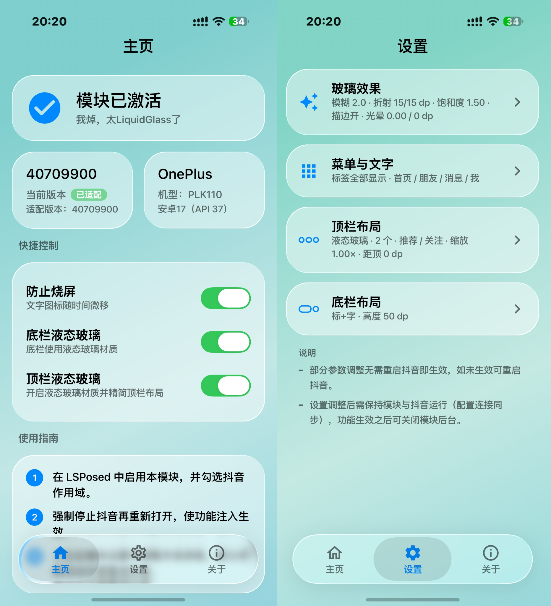
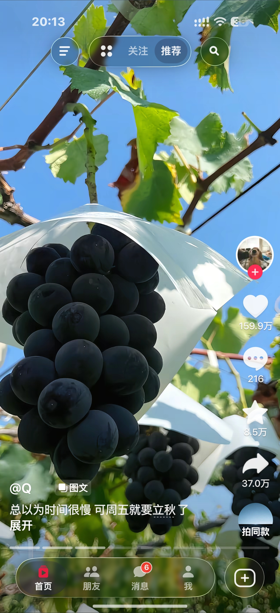

# LiquidTab

LiquidTab 是适用于 LSPosed 的 Android 液态底栏模块。本构建只保留抖音适配：模块管理界面、
统一玻璃渲染核心，以及抖音专属的底栏渲染与页面状态代码。应用 ID 为
`io.github.xzdw.dylt`；1.6 起由 `io.github.offlineglass` 更名，两个包不共享配置。

## 下载

[](https://github.com/xzdw01/DouYinLiquidTab/releases/tag/v1.7.4)

**[⬇️ 一键下载 LiquidTab 1.7.4 APK](https://github.com/xzdw01/DouYinLiquidTab/releases/download/v1.7.4/DouYinLiquidTab-1.7.4-release.apk)**

- 版本：1.7.4（code 18）
- SHA-256：`DDC5067CAD7BF8AA8FE0296F6549E2DB272F0AE38A09D56801942310953FD38B`
- 安装前确认已启用 LSPosed 并勾选抖音；如果装过 debug/其它签名版本，先卸载再安装。

## 界面预览

| 模块管理界面 | 抖音底栏效果 |
| --- | --- |
|  |  |

## 运行条件

- Android 15（API 35）或更高版本
- 已安装并启用 LSPosed；LiquidTab 的作用域为抖音
- **需要支持 libxposed 模块 API 的 LSPosed**（模块只提供新入口 `META-INF/xposed/java_init.list`，
  旧的 `assets/xposed_init` 入口与其 `de.robv` API 已移除）
- 激活状态由 LSPosed 的模块服务（libxposed service API 101 及以上）上报，模块自身不记录激活时间；
  服务/作用域/正在被 Hook 的进程都直接来自框架
- 建议每次设置应用适配后重启目标应用进程

模块离线运行，不需要账号、网络授权或在线更新。底栏设置通过本地配置接口传递给目标进程。

## 当前正式适配范围

本构建**只适配抖音（`com.ss.android.ugc.aweme`）**。作用域由 `app/src/main/resources/META-INF/xposed/scope.list`
提供，模块页面清单由 `AppCatalog` 管理，两者都由 `tools/verify-adapter-workspaces.ps1` 校验。

抖音底栏按参考稿实现为扁平样式：左侧胶囊内是四个纯文字入口（首页 / 朋友 / 消息 / 我），
选中项落在卡其棕色实心胶囊上；右侧是一个独立的圆形发布按钮（描边圆角方框加号），
与胶囊之间留 6dp 间隙。浅色模式使用参考稿的奶油白玻璃与卡其胶囊配色，深色模式自动适配。

其它应用的适配目录、作用域条目、图标素材与共享代码中的专属分支已全部移除。

## 主要设置与默认值

- 液态玻璃：开启；底部渐变模糊：关闭
- 模糊半径：2；底栏高度：56 dp；页面间距：12 dp；单栏宽度：76 dp
- 深浅色底色透明度固定为 40%；深色高光描边强度默认 50%
- 底栏显示样式（外观与模式）：图标 + 文字（默认，图标在上文字在下）、仅图标、仅文字；后两者只画单个元素并在胶囊内上下居中，胶囊尺寸与点击区域不变
- 底栏菜单项隐藏：首页 / 朋友 / 消息 / 我 四个入口默认全部显示；关闭某个开关后抖音底栏不再显示该入口（底栏尺寸不变，其余入口均匀排列），最多可关闭 3 个，最后一个入口开关会锁定为灰色不可关闭
- 底栏菜单文字：为这四个入口自定义昵称，输入框内的灰色字为原昵称，留空即恢复原昵称，点「保存」后抖音底栏立即生效（仅影响模块绘制的底栏文字）
- 顶栏参数：顶栏距屏幕顶部边距（默认 ±0 dp，范围 ±32 dp）、整体缩放（默认 1.00×，范围 0.80–1.25×），默认值即当前写死的效果，改动即时生效；顶栏高度固定跟随抖音标题栏（约 40 dp），不提供调节
- 顶栏按钮与标签：可分别隐藏左侧抽屉按钮、右侧搜索按钮，隐藏后剩余内容自动居中；顶栏标签数量可选 1–4 个（默认 2 个）；「标签页排序」页中拖动右侧手柄调整顺序，前 N 个标签在顶栏从右到左显示，推荐固定第一个（最右侧），不能拖动；位置标签统一显示为「同城」（不随定位变化）
- 圆角连续曲线、底色透明度使用设计默认值，不提供独立滑块

## 项目结构

- `app/src/main/java/io/github/xzdw/dylt/hook/adapters/douyin/`：抖音专属配置、适配器、导航渲染、页面状态与 Hook 信号。
- `app/src/main/java/io/github/xzdw/dylt/hookx/`：libxposed API 门面（`Xposed`/`MethodHook`），全部框架调用只在这里。
- `app/src/main/java/io/github/xzdw/dylt/framework/`：框架模块服务的激活状态与 remote preferences 接入。
- `app/src/main/java/io/github/xzdw/dylt/targets/`：应用配置登记表与管理列表。
- `app/src/main/java/io/github/xzdw/dylt/hook/`：模块入口、适配调度、通用导航发现和共享宿主/绘制生命周期。
- `app/src/main/java/io/github/xzdw/dylt/rendering/`：跨应用共享的液态玻璃、模糊和材质绘制实现。
- `app/src/main/java/io/github/xzdw/dylt/config/`：模块及目标应用共用的配置协议、默认值和本地存储。
- `app/src/main/java/io/github/xzdw/dylt/ui/`：模块主页、应用列表、设置页和说明二级页面。
- `design/`、`docs/`：设计规范和开发文档。

新增应用适配时，先阅读 `docs/` 下的开发文档。适配专属逻辑优先放在对应应用目录；
确需修改共享 Hook、配置或渲染核心时，必须做回归检查。设备日志和本机交接记录不纳入公开源码。

## 构建

需要 JDK 21、Android SDK Platform 37、Build Tools 37 和网络可用的 Gradle 依赖源。Windows PowerShell：

```powershell
./gradlew.bat :app:assembleRelease
```

Linux/macOS 下如果 `gradlew` 没有执行权限，先 `chmod +x gradlew`。

适配目录和 LSPosed 作用域一致性检查：

```powershell
pwsh -NoProfile -File tools/verify-adapter-workspaces.ps1
```

Release 构建产物默认位于 `app/build/outputs/apk/release/`。工程不携带签名密钥，也不在源码中设置个人签名信息；发布者应使用自己的密钥签名，并安全保存密钥。

## 开源与第三方材料

LiquidTab 源码按 GNU GPL v3 发布，完整文本见 `LICENSE`。直接依赖及授权说明见 `NOTICE.md`。随 APK 使用的若干应用导航图标属于第三方应用素材，详见 `THIRD_PARTY_ASSETS.md`；本项目许可证不授予这些素材的额外权利。请在公开分发前确认相关素材的授权范围。

本工程不包含第三方应用 APK、反编译输出、用户数据、签名密钥或设备调试记录。赞赏码由项目作者提供，仅用于模块说明页。
